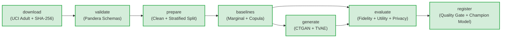

# SynthGuard-Ops 🛡️

> **Quality-Gated Synthetic Tabular Data Pipeline**  
> MLOps Course Project — FAST National University (BSCS 2023)  
> Target: **Deliverable 1** (Due: Sun Nov 22, 2026)

---

## 📌 Project Overview

**SynthGuard-Ops** is an end-to-end, production-grade MLOps pipeline designed to generate, validate, and evaluate synthetic tabular data using the UCI **Adult Income** dataset. 

Synthetic tabular data must satisfy three critical requirements before enterprise release:
1. **Fidelity:** Statistical alignment and correlation preservation with real data.
2. **Utility:** Downstream machine learning performance parity (Train on Synthetic, Test on Real — TSTR vs. TRTR).
3. **Privacy:** Protection against empirical inference attacks (Membership Inference Attack AUC, Distance to Closest Record, and exact-match rate).

SynthGuard-Ops enforces strict quality and privacy gates, tracks every candidate generator run in **MLflow**, versions code and datasets with **Git + DVC**, and registers the champion generator to the MLflow Model Registry.

---

## 👥 Team & Ownership

| Team Member | Role | Workstream & Ownership |
|---|---|---|
| **Turab Haider** | MLOps & Platform Lead | Project scaffolding, DVC pipeline configuration, MLflow tracking & Model Registry, Dockerization, CI/CD, Deliverable 1 submission. |
| **Muhammad Nufil Anwer** | Data & Generation Lead | Data ingestion & integrity checks, Pandera schema validation, leakage-free data splits, synthetic generators (Marginal, Gaussian Copula, CTGAN, TVAE). |
| **Muhammad Faizan** | Evaluation & Metrics Lead | Metrics formalization, fidelity scoring (SDMetrics), downstream utility evaluation (TSTR/TRTR), privacy risk assessment (MIA, DCR), quality gating. |

---

## 🔄 Pipeline Architecture (DVC DAG)



---

## ✅ Work Completed So Far

### 1. Platform & Tooling Scaffolding (`T01` – `T03`, `T12`)
- **Repository & Environment:** Initialized Python 3.11 environment with `pyproject.toml`, pinned dependencies (`requirements.lock`), code formatting and linting rules (`ruff`), and pre-commit hooks.
- **Data Version Control (DVC):** Initialized DVC tracking with autostage disabled to preserve strict multi-author git attribution.
- **Experiment Tracking (MLflow):** Implemented `synthguard.tracking.mlflow_utils` with automatic tagging of Git commit SHAs, DVC data MD5 hashes, and candidate metadata. Local tracking store backed by SQLite (`mlflow.db`).
- **Containerization (`T12`):** Multi-stage CPU-only `Dockerfile` and `.dockerignore` for containerized execution.

### 2. Raw Data Ingestion & EDA (`T04` — Merged via PR #3)
- **Download Stage:** Automated download of the UCI Adult dataset from the official UCI repository with cryptographic SHA-256 verification (`src/synthguard/data/download.py` & `src/synthguard/stages/download.py`).
- **Exploratory Data Analysis:** Authored `notebooks/01_eda.ipynb` covering:
  - Feature distributions and missing value analysis (`?` characters).
  - Class imbalance quantification (~24.08% positive `>50K` class).
  - Duplicate detection (24 exact duplicate rows identified in raw data).

### 3. Schema Validation Stage (`T05` — Merged via PR #3)
- **Pandera Schemas:** Defined strict `RAW_SCHEMA` and `PROCESSED_SCHEMA` in `src/synthguard/data/schema.py` enforcing:
  - Column ordering, exact data types, and non-negative constraints.
  - Value ranges (e.g., `age` [17–90], `hours_per_week` [1–99]).
  - Categorical domain constraints and handling of missing categories (`"Unknown"`).
  - DataFrame-level health checks: minimum row count ($\ge 30,000$), maximum null tolerance ($\le 10\%$).
- **Validation Stage:** `src/synthguard/stages/validate.py` executes lazy validation, dumps errors to `reports/validation/raw.json`, and halts pipeline execution on corruption.
- **Unit Tests:** `tests/test_validation.py` asserting that schema checks reliably catch invalid dtypes, out-of-range values, missing columns, and unseen categories.

### 4. Leakage-Free Data Preparation & Stratified Split (`T06` — Merged via PR #3)
- **Data Cleansing:** Stripped whitespace from categorical strings, transformed missing markers (`?` $\rightarrow$ `"Unknown"`), and normalized target labels.
- **Leakage Prevention:** Removed the 24 duplicate records **prior** to splitting to avoid train/test contamination.
- **Stratified Split:** Split data into 70% training (`train.csv`) and 30% holdout (`holdout.csv`) with `seed=42`.
  - Raw dataset: **32,561** rows.
  - Cleaned dataset: **32,537** rows.
  - Train set: **22,775** rows (positive rate: **24.09%**).
  - Holdout set: **9,762** rows (positive rate: **24.09%**).
- **Metadata & Tracking:** Generated SDV-compatible table metadata and logged split summary to `metrics/prepare.json`.

### 5. Metrics Specification & Evaluation Modules (`T07`, `T10`, `T11`, `T13`)
- **Metrics Specification (`T07`):** Authored `docs/metrics.md` detailing formal mathematical definitions for Quality Score, TRTR/TSTR protocol, utility ratio, Distance to Closest Record (DCR), exact-match rate, distance-based Membership Inference Attack (MIA AUC & advantage), and composite scoring.
- **Fidelity Module (`T10`):** `src/synthguard/evaluation/fidelity.py` computing SDMetrics QualityReport, shape/trend adherence, KS-test, total variation distance, and correlation matrix delta.
- **Utility Module (`T11`):** `src/synthguard/evaluation/utility.py` training Random Forest and XGBoost classifiers on real vs. synthetic data to benchmark TSTR vs. TRTR ROC-AUC, F1-score, and utility ratio.
- **Privacy Module (`T13`):** `src/synthguard/evaluation/privacy.py` computing empirical privacy metrics including 5th-percentile DCR, DCR ratio ($\text{DCR}_{\text{synth}} / \text{DCR}_{\text{real}}$), exact match count, and distance-based MIA AUC using holdout non-members.

### 6. Synthetic Data Generators (`T08`, `T09` — Merged via PR #13)
- **Generator Interface (`T08`):** `src/synthguard/generators/base.py` defining standard `Generator` protocol (`fit`, `sample`, `save`, `load`) with built-in telemetry tracking fit time, sample time, and peak memory usage (`psutil`).
- **Baseline Models (`T08`):** 
  - `IndependentMarginalSampler`: Fast empirical distribution baseline.
  - `GaussianCopulaSynthesizer`: Classical multivariate statistical copula baseline.
  - `baselines` stage: Fits and logs `trtr_reference`, `marginal`, and `gaussian_copula` candidate runs to MLflow (`metrics/baselines.json`, `metrics/runs_baselines.json`).
- **Deep Generative Synthesizers (`T09`):**
  - Integrated SDV 2.2 deep models: **CTGAN** and **TVAE** (`src/synthguard/generators/sdv_models.py`).
  - `generate` stage (`src/synthguard/stages/generate.py`): Depends on `baselines` outputs, trains CTGAN (100 epochs) and TVAE (100 epochs), and outputs synthetic datasets (`metrics/primary.json`, `metrics/runs_primary.json`).
  - Benchmark timings on CPU: CTGAN fit ~155.0 s, TVAE ~37.4 s, Gaussian Copula ~3.35 s, Marginal ~0.008 s for 9,762 synthetic rows.
- **DVC Pipeline Integration:** Pinned full DAG through `generate` stage in `dvc.yaml` and `dvc.lock`.

### 7. Parameter Wiring & Generator Pipeline Tests (`T15`, `T20` — Merged via PR #19)
- **Hyperparameter & DVC Tracking Wiring (`T15`):** Added comprehensive wiring checks in `tests/test_params_wiring.py`:
  - Verified that every parameter declared in `dvc.yaml` exists in `params.yaml`.
  - Confirmed stage-specific tracking: `generate` tracks `seed` and `generators.ctgan`/`tvae`, `baselines` tracks baseline parameters, and data stages track their respective parameters.
  - Enforced that all CTGAN/TVAE hyperparameter keys in `params.yaml` map directly to valid SDV `CTGANSynthesizer` and `TVAESynthesizer` arguments to catch configuration typos early.
  - Verified parameter pass-through from `params.yaml` directly to model initializations.
- **Training Runner & Generate-Stage Guards (`T20`):** Added robust tests in `tests/test_runner.py`:
  - Seeded smoke subsampling (1,000 rows) and synthetic sample size invariance.
  - Verified `train_candidate` produces expected outputs (CSV data, model pkl) and logs MLflow runs with tags, parameters, and telemetry metrics.
  - Guaranteed reproducibility of Gaussian Copula generation and SDV model serialization/deserialization round-trips.
  - Tested fail-fast guard in `src/synthguard/stages/generate.py` that strictly requires `metrics/baselines.json` before training commences.
- **Planted Bugs & DVC Granular Invalidation:** Demonstrated that editing `generators.ctgan.epochs` in `params.yaml` invalidates only the `generate` stage in `dvc status`. Verified that deliberately planted bugs (untracked params, `epoch` typo, missing baselines guard) reliably trigger immediate test failures.

---

## ⏳ Pending Work (Roadmap to Deliverable 1)

| Task ID | Owner | Workstream | Description | Status |
|---|---|---|---|---|
| **T14** | Faizan | Evaluation | Implement `evaluate` stage: run candidate evaluations, compute composite selection score, and apply privacy gate. | In progress |
| **T15** | Nufil | Generation | Ensure generator parameters and RNG seeds are fully controlled via `params.yaml` with verified DVC repro triggers. | **Done** (PR #19) |
| **T16** | Turab | Platform | Implement MLflow Model Registry stage: register champion generator under alias `champion`. | **Done** (PR #11, PR #14) |
| **T17** | All | Milestone | Full end-to-end pipeline run from raw download through champion model registration. | In progress |
| **T18** | Turab | Platform | Configure `docker-compose.yml` for zero-configuration, single-command pipeline reproduction. | **Done** (PR #10) |
| **T19** | Turab | Platform | Setup GitHub Actions CI pipeline running linting, unit tests, determinism, and repro checks. | **Done** (PR #9, PR #17) |
| **T20** | Nufil | Data/Generation | Expand unit tests for synthetic data distributions, column structures, and generator determinism. | **Done** (PR #19) |
| **T21** | Faizan | Evaluation | Unit tests with synthetic known-answer fixtures for composite score and gate logic. | **Done** (PR #16) |
| **T22** | Nufil | Verification | Fresh-clone reproduction audit to verify score reproducibility within tolerance ($\pm 0.02$). | Next up |
| **T23** | Faizan | Documentation | Compile model comparison and selection evidence table in `reports/results.md`. | In progress |
| **T24** | Turab | Platform | Generate MLflow run exports (`submission/mlflow_runs.csv`) and UI screenshots. | **Done** (PR #12) |
| **T25** | All | Buffer | Final code review, pre-commit audit, and branch cleanup. | Pending |
| **T26** | Turab | Submission | Package deliverables and submit to Google Classroom. | Pending |

---

## 📂 Repository Structure

```
SynthGuard-Ops/
├── .dockerignore                     # Docker build exclusions
├── Dockerfile                        # Multi-stage CPU container
├── .dvc/                             # DVC internal configuration
├── data/                             # Versioned data artifacts (DVC managed)
│   ├── raw/                          # adult.data (download stage)
│   ├── processed/                    # train.csv, holdout.csv, metadata.json (prepare stage)
│   └── synthetic/                    # Generated synthetic datasets (<model>.csv)
├── docs/                             # Project documentation
│   └── metrics.md                    # Formal metric specifications (T07)
├── metrics/                          # Tracked lightweight metric summaries
│   ├── prepare.json                  # Dataset split and duplicate counts (T06)
│   ├── baselines.json                # Marginal & Gaussian Copula timings (T08)
│   ├── runs_baselines.json           # MLflow run IDs for baselines (T08)
│   ├── primary.json                  # CTGAN & TVAE timings (T09)
│   └── runs_primary.json             # MLflow run IDs for primary models (T09)
├── models/                           # Serialized generator artifacts (DVC managed)
├── notebooks/                        # Jupyter notebooks for data analysis
│   └── 01_eda.ipynb                  # Exploratory Data Analysis (T04)
├── reports/                          # Generated evaluation and validation reports
│   └── validation/                   # Pandera raw and processed schema check results
├── src/synthguard/                   # Core Python package
│   ├── config.py                     # Parameter loader & seed management
│   ├── data/                         # Ingestion, schema, and processing modules
│   │   ├── download.py
│   │   ├── schema.py
│   │   ├── validate.py
│   │   └── prepare.py
│   ├── generators/                   # Synthetic data models (T08, T09)
│   │   ├── base.py                   # Generator abstract base class
│   │   ├── marginal.py               # Independent marginal sampler
│   │   ├── runner.py                 # Fit & telemetry runner
│   │   └── sdv_models.py             # Gaussian Copula, CTGAN, TVAE wrappers
│   ├── evaluation/                   # Evaluation modules (T10, T11, T13)
│   │   ├── fidelity.py               # SDMetrics quality score & distributions
│   │   ├── utility.py                # TRTR vs TSTR (RF & XGBoost)
│   │   └── privacy.py                # DCR, exact match, MIA AUC
│   ├── stages/                       # Thin CLI entry points invoked by DVC
│   │   ├── download.py
│   │   ├── validate.py
│   │   ├── prepare.py
│   │   ├── baselines.py
│   │   └── generate.py
│   └── tracking/                     # MLflow experiment tracking utilities
│       └── mlflow_utils.py
├── tests/                            # Test suite
│   ├── conftest.py
│   ├── test_config.py
│   ├── test_evaluate_stage.py
│   ├── test_export.py
│   ├── test_fidelity.py
│   ├── test_generators.py
│   ├── test_metric_known_answers.py
│   ├── test_mlflow_utils.py
│   ├── test_params_wiring.py         # Hyperparameters & DVC wiring tests (T15)
│   ├── test_privacy.py
│   ├── test_register_stage.py
│   ├── test_registry.py
│   ├── test_runner.py                # Generator training runner & stage guards (T20)
│   ├── test_score.py
│   ├── test_split.py
│   ├── test_utility.py
│   └── test_validation.py
├── dvc.yaml                          # DVC pipeline stage definitions (download -> register)
├── dvc.lock                          # Pinned stage inputs, outputs, and hashes
├── Makefile                          # Command runners (setup, lint, test, reproduce)
├── params.yaml                       # Pipeline hyperparameters & configuration
├── pyproject.toml                    # Package metadata & tool settings
└── requirements.lock                 # Pinned dependencies
```

---

## 🚀 How to Run & Verify

### ▶️ Reproduce in one command (Docker)

Requirements: Docker (Desktop on macOS/Windows, Engine on Linux) and internet access for the
UCI download. No Python setup, DVC remote or credentials needed.

```bash
git clone https://github.com/turab1020/SynthGuard-Ops.git
cd SynthGuard-Ops
docker compose run --rm pipeline
```

This builds the CPU-only image (first time only), mounts the clone at `/app` and runs
`make reproduce` (`dvc repro` + `dvc metrics show`) inside it. Every output lands in the clone:
`data/`, `models/`, `metrics/*.json`, `reports/`, `dvc.lock` and the MLflow store `mlflow.db`.

```bash
docker compose up mlflow        # MLflow UI on http://localhost:5001  (Ctrl+C to stop)
```

Notes
- DVC only re-runs a stage when its code, data or parameters changed. The raw-data validation
  report is committed, so after the download produces the same SHA-256 the `validate` stage is
  reported as unchanged and its recorded result (`reports/validation/raw.json`) is reused.
  Force every stage with `docker compose run --rm pipeline dvc repro --force`.
- On Linux, if your user id is not 1000, run `HOST_UID=$(id -u) HOST_GID=$(id -g) docker compose run --rm pipeline`
  so files written into the clone are owned by you.
- Without Docker: `make setup && make reproduce`.

### 🔁 What "reproduces" means here

**The one command reproduces the registered model choice (TVAE), with selection scores within ±0.02 across CPU types.** Scores are not bit-identical across CPU models: repeated runs on one machine are identical, but different CPUs use different low-level numeric routines, so CTGAN and TVAE train to slightly different networks.

Committed reference: Docker fresh-clone run on GitHub Actions (x86_64 Linux), TVAE **0.908011**, CTGAN **0.900101**.

| Environment | CTGAN score (Δ vs reference) | TVAE score (Δ vs reference) | Selected by the tie rule |
|---|---|---|---|
| **Reference** (Docker, x86_64 Linux) | 0.900101 | 0.908011 | TVAE |
| AMD EPYC 9V45 / 9V74 | 0.897160 (−0.0029) | 0.905247 (−0.0028) | TVAE |
| Intel Xeon Platinum 8573C | 0.900956 (+0.0009) | 0.905794 (−0.0022) | TVAE |
| macOS arm64 (native, no Docker) | 0.905879 (+0.0058) | 0.904732 (−0.0033) | TVAE |
| Intel Xeon 8573C, AVX2 forced (diagnostic) | 0.903353 (+0.0033) | 0.895534 (−0.0125) | TVAE |

- Largest difference from the reference: **0.0125**, inside the ±0.02 tolerance.
- CTGAN and TVAE are closer than this CPU-to-CPU variation, so `selection.tie_tolerance: 0.02` in `params.yaml` treats them as tied and picks the faster to train (TVAE, 4–5× faster on every CPU measured).
- Scope of the evidence: the reference and macOS rows are full pipeline runs. The other rows retrain and score CTGAN and TVAE only, with the rule applied to those two scores.
- Known limit: Gaussian Copula (0.8827) is 0.0253 below the reference top score. If a machine's top score fell below about 0.9027, it would join the tie and win as the fastest. The closest case measured was 0.9029 (0.0202 above it).

### 1. Environment Setup
```bash
# Create venv and install package in editable mode with dev dependencies
make setup
```

### 2. Run Tests & Code Quality Checks
```bash
# Run Ruff linting and formatting verification
make lint

# Execute pytest suite across all test modules
make test
```

### 3. Reproduce Pipeline Stages (via DVC)
```bash
# Reproduce data and generator stages (download -> validate -> prepare -> baselines -> generate)
dvc repro generate

# View pipeline DAG
dvc dag

# Inspect logged metrics
dvc metrics show
```

### 4. MLflow Tracking UI
```bash
# Launch MLflow tracking UI on http://localhost:5001 (macOS AirPlay uses port 5000)
make ui
# View candidate runs: trtr_reference, marginal, gaussian_copula, ctgan, tvae
```
