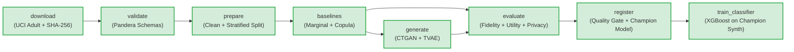

# SynthGuard-Ops 🛡️

> **Quality-Gated Synthetic Tabular Data Pipeline**  
> MLOps Course Project — FAST National University (BSCS 2023)  
> Status: **Deliverable 1** (Completed) | **Deliverable 2** (In Progress)

---

## 📌 Project Overview

**SynthGuard-Ops** is an end-to-end, production-grade MLOps pipeline designed to generate, validate, and evaluate synthetic tabular data using the UCI **Adult Income** dataset. 

Synthetic tabular data must satisfy three critical requirements before enterprise release:
1. **Fidelity:** Statistical alignment and correlation preservation with real data.
2. **Utility:** Downstream machine learning performance parity (Train on Synthetic, Test on Real — TSTR vs. TRTR).
3. **Privacy:** Protection against empirical inference attacks (Membership Inference Attack AUC, Distance to Closest Record, and exact-match rate).

SynthGuard-Ops enforces strict quality and privacy gates, tracks every candidate generator run in **MLflow**, versions code and datasets with **Git + DVC**, and registers the champion generator to the MLflow Model Registry.

---

## 👥 Team & Ownership

| Team Member | Role | Workstream & Ownership |
|---|---|---|
| **Turab Haider** | MLOps & Platform Lead | Project scaffolding, DVC pipeline configuration, MLflow tracking & Model Registry, Dockerization, CI/CD, Deliverable 1 submission. |
| **Muhammad Nufil Anwer** | Data & Generation Lead | Data ingestion & integrity checks, Pandera schema validation, leakage-free data splits, synthetic generators (Marginal, Gaussian Copula, CTGAN, TVAE), downstream income classifier (`train_classifier`). |
| **Muhammad Faizan** | Evaluation & Metrics Lead | Metrics formalization, fidelity scoring (SDMetrics), downstream utility evaluation (TSTR/TRTR), privacy risk assessment (MIA, DCR), quality gating. |

---

## 🔄 Pipeline Architecture (DVC DAG)



---

## 🌐 Live deployment (Deliverable 2)

**Live API:** https://synthguard-ops.onrender.com · interactive docs: https://synthguard-ops.onrender.com/docs

| Endpoint | What it does |
|---|---|
| `GET /health` | Service status, model version, deployed commit |
| `POST /predict` | Income prediction (`>50K` / `<=50K`), probability, confidence and TreeSHAP explanation (top features) |
| `GET /metrics` | Prometheus metrics: requests, latency, errors, predictions, drift |
| `GET /generate?n=` | Synthetic rows from the champion generator; **off on Render** (needs torch/SDV), on locally with `make serve` |

```bash
curl -s https://synthguard-ops.onrender.com/health
curl -s -X POST https://synthguard-ops.onrender.com/predict -H 'Content-Type: application/json' -d '{
  "age": 45, "workclass": "Private", "fnlwgt": 190000, "education": "Masters", "education_num": 14,
  "marital_status": "Married-civ-spouse", "occupation": "Exec-managerial", "relationship": "Husband",
  "race": "White", "sex": "Male", "capital_gain": 0, "capital_loss": 0, "hours_per_week": 50,
  "native_country": "United-States"}'
```

- **Hosting:** Render free Docker web service (Oregon), built from `Dockerfile.serve` (no torch/SDV, fits 512 MB).
  The free instance sleeps when idle: the first request after a sleep takes about a minute.
  Warm it up with `python scripts/smoke_test_api.py --url https://synthguard-ops.onrender.com`.
- **Deploys only through the gate:** on every merge to `main`, `deploy.yml` runs lint, tests, data validation,
  the evaluation gate and a 512 MB image smoke test; only then it calls Render's deploy hook, waits until the
  live `/health` reports the new commit, and smoke-tests the live URL. Render auto-deploy is off.

---

## 📈 Observability (local demo stack)

```bash
docker compose -f docker-compose.monitoring.yml up --build
```

| Service | URL | What it shows |
|---|---|---|
| API (same image as Render) | http://localhost:8000/docs | live predictions; requests logged to `monitoring/logs/requests.jsonl` for drift checks |
| Prometheus | http://localhost:9090 | scrapes the local API **and the live Render service** (`/metrics`) |
| Grafana | http://localhost:3000 | dashboard "SynthGuard serving": request rate, p50/p95/p99 latency, 5xx error rate, predictions by label, prediction drift, input drift share |

Metrics exported by the API: `synthguard_requests_total`, `synthguard_request_latency_seconds`,
`synthguard_errors_total`, `synthguard_predictions_total`, `synthguard_prediction_probability`, `synthguard_drift_share`.

---

## 🎯 Deliverable 1: Requirements and Results

### How each requirement is met

| Requirement | How it is met | Where to check |
|---|---|---|
| Versioned data | DVC stages download, prepare and generate the data; `dvc.lock` pins every hash; the raw file has a pinned SHA-256 | [`dvc.yaml`](dvc.yaml), [`dvc.lock`](dvc.lock), [`.dvc/config`](.dvc/config), [`params.yaml`](params.yaml) |
| Schema and quality checks before training | pandera checks columns, dtypes, ranges, categories, nulls and row count; the pipeline stops on bad input | [`schema.py`](src/synthguard/data/schema.py), [`test_validation.py`](tests/test_validation.py) |
| Leakage-free split | Exact duplicates removed **before** a stratified 70/30 split (seed 42); generators see train only; a test asserts zero shared rows | [`prepare.py`](src/synthguard/data/prepare.py), [`test_split.py`](tests/test_split.py) |
| Baseline before the primary model | The `baselines` stage (independent marginal, Gaussian Copula, real-data TRTR reference) must finish before `generate` (CTGAN, TVAE) | [`baselines.py`](src/synthguard/stages/baselines.py), [`dvc.yaml`](dvc.yaml) |
| Experiment tracking | One MLflow run per candidate with hyperparameters, git commit, data hashes and all metrics | [`mlflow_runs.csv`](submission/mlflow_runs.csv), [`mlflow_utils.py`](src/synthguard/tracking/mlflow_utils.py) |
| Registered top model | Privacy gate, then selection score and tie rule; winner registered as `synthguard-generator@champion` | [`registered_models.json`](submission/registered_models.json), [`registered.json`](metrics/registered.json), [`register.py`](src/synthguard/stages/register.py) |
| One-command reproduction | `docker compose run --rm pipeline` rebuilds everything from a fresh clone | "Reproduce in one command" below, [`docker-compose.yml`](docker-compose.yml), [`reproducibility.md`](reports/reproducibility.md) |

### Results

Registered model: **TVAE**, `synthguard-generator` version 1, alias `champion`. Real-data reference (TRTR) Random Forest ROC-AUC: 0.9091. Serving classifier trained only on TVAE's synthetic data: hold-out ROC-AUC 0.8844 (`metrics/classifier.json`, the production benchmark).

| Generator | Selection score | Quality | Utility ratio | MIA AUC | DCR ratio | Exact match | Fit time (s) |
|---|---|---|---|---|---|---|---|
| **TVAE (registered)** | 0.9058 | 0.8434 | 0.9682 | 0.4914 | 0.6297 | 0.0000 | 61.17 |
| CTGAN | 0.8984 | 0.8380 | 0.9587 | 0.4967 | 12.9558 | 0.0000 | 210.52 |
| Gaussian Copula (baseline) | 0.8827 | 0.8420 | 0.9234 | 0.4992 | 13.0881 | 0.0000 | 4.14 |
| Independent marginal (baseline) | 0.6841 | 0.8787 | 0.4896 | 0.5024 | 13.1747 | 0.0000 | 0.01 |

- All four candidates pass the privacy gate (MIA AUC ≤ 0.60, exact-match rate ≤ 0.01).
- `selection_score = 0.5 × quality + 0.5 × utility_ratio`. Scores within 0.02 of the best are tied, and the faster to train wins. TVAE and CTGAN are tied; TVAE is both higher here and faster.
- **TVAE's DCR ratio is 0.6297 (below 1):** its rows sit closer to training rows than real hold-out rows do, a mild memorisation signal. Its exact-match rate is 0.0000 and its MIA AUC is 0.4914 (about chance), so neither test shows a leak. DCR is reported but is not part of the gate. These are empirical risk estimates, not formal privacy guarantees.
- These are the Deliverable 2 reference numbers. The Deliverable 1 submission evidence in `submission/` comes from the D1 reference run (TVAE 0.9080); both select TVAE.

---

## ✅ Work Completed So Far

### 1. Platform & Tooling Scaffolding (`T01` – `T03`, `T12`)
- **Repository & Environment:** Initialized Python 3.11 environment with `pyproject.toml`, pinned dependencies (`requirements.lock`), code formatting and linting rules (`ruff`), and pre-commit hooks.
- **Data Version Control (DVC):** Initialized DVC tracking with autostage disabled to preserve strict multi-author git attribution.
- **Experiment Tracking (MLflow):** Implemented `synthguard.tracking.mlflow_utils` with automatic tagging of Git commit SHAs, DVC data MD5 hashes, and candidate metadata. Local tracking store backed by SQLite (`mlflow.db`).
- **Containerization (`T12`):** Multi-stage CPU-only `Dockerfile` and `.dockerignore` for containerized execution.

### 2. Raw Data Ingestion & EDA (`T04` — Merged via PR #3)
- **Download Stage:** Automated download of the UCI Adult dataset from the official UCI repository with cryptographic SHA-256 verification (`src/synthguard/data/download.py` & `src/synthguard/stages/download.py`).
- **Exploratory Data Analysis:** Authored `notebooks/01_eda.ipynb` covering:
  - Feature distributions and missing value analysis (`?` characters).
  - Class imbalance quantification (~24.08% positive `>50K` class).
  - Duplicate detection (24 exact duplicate rows identified in raw data).

### 3. Schema Validation Stage (`T05` — Merged via PR #3)
- **Pandera Schemas:** Defined strict `RAW_SCHEMA` and `PROCESSED_SCHEMA` in `src/synthguard/data/schema.py` enforcing:
  - Column ordering, exact data types, and non-negative constraints.
  - Value ranges (e.g., `age` [17–90], `hours_per_week` [1–99]).
  - Categorical domain constraints and handling of missing categories (`"Unknown"`).
  - DataFrame-level health checks: minimum row count ($\ge 30,000$), maximum null tolerance ($\le 10\%$).
- **Validation Stage:** `src/synthguard/stages/validate.py` executes lazy validation, dumps errors to `reports/validation/raw.json`, and halts pipeline execution on corruption.
- **Unit Tests:** `tests/test_validation.py` asserting that schema checks reliably catch invalid dtypes, out-of-range values, missing columns, and unseen categories.

### 4. Leakage-Free Data Preparation & Stratified Split (`T06` — Merged via PR #3)
- **Data Cleansing:** Stripped whitespace from categorical strings, transformed missing markers (`?` $\rightarrow$ `"Unknown"`), and normalized target labels.
- **Leakage Prevention:** Removed the 24 duplicate records **prior** to splitting to avoid train/test contamination.
- **Stratified Split:** Split data into 70% training (`train.csv`) and 30% holdout (`holdout.csv`) with `seed=42`.
  - Raw dataset: **32,561** rows.
  - Cleaned dataset: **32,537** rows.
  - Train set: **22,775** rows (positive rate: **24.09%**).
  - Holdout set: **9,762** rows (positive rate: **24.09%**).
- **Metadata & Tracking:** Generated SDV-compatible table metadata and logged split summary to `metrics/prepare.json`.

### 5. Metrics Specification & Evaluation Modules (`T07`, `T10`, `T11`, `T13`)
- **Metrics Specification (`T07`):** Authored `docs/metrics.md` detailing formal mathematical definitions for Quality Score, TRTR/TSTR protocol, utility ratio, Distance to Closest Record (DCR), exact-match rate, distance-based Membership Inference Attack (MIA AUC & advantage), and composite scoring.
- **Fidelity Module (`T10`):** `src/synthguard/evaluation/fidelity.py` computing SDMetrics QualityReport, shape/trend adherence, KS-test, total variation distance, and correlation matrix delta.
- **Utility Module (`T11`):** `src/synthguard/evaluation/utility.py` training Random Forest and XGBoost classifiers on real vs. synthetic data to benchmark TSTR vs. TRTR ROC-AUC, F1-score, and utility ratio.
- **Privacy Module (`T13`):** `src/synthguard/evaluation/privacy.py` computing empirical privacy metrics including 5th-percentile DCR, DCR ratio ($\text{DCR}_{\text{synth}} / \text{DCR}_{\text{real}}$), exact match count, and distance-based MIA AUC using holdout non-members.

### 6. Synthetic Data Generators (`T08`, `T09` — Merged via PR #13)
- **Generator Interface (`T08`):** `src/synthguard/generators/base.py` defining standard `Generator` protocol (`fit`, `sample`, `save`, `load`) with built-in telemetry tracking fit time, sample time, and peak memory usage (`psutil`).
- **Baseline Models (`T08`):** 
  - `IndependentMarginalSampler`: Fast empirical distribution baseline.
  - `GaussianCopulaSynthesizer`: Classical multivariate statistical copula baseline.
  - `baselines` stage: Fits and logs `trtr_reference`, `marginal`, and `gaussian_copula` candidate runs to MLflow (`metrics/baselines.json`, `metrics/runs_baselines.json`).
- **Deep Generative Synthesizers (`T09`):**
  - Integrated SDV 2.2 deep models: **CTGAN** and **TVAE** (`src/synthguard/generators/sdv_models.py`).
  - `generate` stage (`src/synthguard/stages/generate.py`): Depends on `baselines` outputs, trains CTGAN (100 epochs) and TVAE (100 epochs), and outputs synthetic datasets (`metrics/primary.json`, `metrics/runs_primary.json`).
  - Benchmark timings on CPU: CTGAN fit ~155.0 s, TVAE ~37.4 s, Gaussian Copula ~3.35 s, Marginal ~0.008 s for 9,762 synthetic rows.
- **DVC Pipeline Integration:** Pinned full DAG through `generate` stage in `dvc.yaml` and `dvc.lock`.

### 7. Parameter Wiring & Generator Pipeline Tests (`T15`, `T20` — Merged via PR #19)
- **Hyperparameter & DVC Tracking Wiring (`T15`):** Added comprehensive wiring checks in `tests/test_params_wiring.py`:
  - Verified that every parameter declared in `dvc.yaml` exists in `params.yaml`.
  - Confirmed stage-specific tracking: `generate` tracks `seed` and `generators.ctgan`/`tvae`, `baselines` tracks baseline parameters, and data stages track their respective parameters.
  - Enforced that all CTGAN/TVAE hyperparameter keys in `params.yaml` map directly to valid SDV `CTGANSynthesizer` and `TVAESynthesizer` arguments to catch configuration typos early.
  - Verified parameter pass-through from `params.yaml` directly to model initializations.
- **Training Runner & Generate-Stage Guards (`T20`):** Added robust tests in `tests/test_runner.py`:
  - Seeded smoke subsampling (1,000 rows) and synthetic sample size invariance.
  - Verified `train_candidate` produces expected outputs (CSV data, model pkl) and logs MLflow runs with tags, parameters, and telemetry metrics.
  - Guaranteed reproducibility of Gaussian Copula generation and SDV model serialization/deserialization round-trips.
  - Tested fail-fast guard in `src/synthguard/stages/generate.py` that strictly requires `metrics/baselines.json` before training commences.
- **Planted Bugs & DVC Granular Invalidation:** Demonstrated that editing `generators.ctgan.epochs` in `params.yaml` invalidates only the `generate` stage in `dvc status`. Verified that deliberately planted bugs (untracked params, `epoch` typo, missing baselines guard) reliably trigger immediate test failures.

### 8. Fresh-Clone Reproducibility Audit (`T22` — Merged via PR #26)
- **Zero-Config Reproduction Audit:** Verified that running `docker compose run --rm pipeline` from a fresh clone reproduces all outputs and registers the exact same champion model (**TVAE**).
- **Metric Invariance:** All four candidate generator selection scores matched the committed metrics to 6 decimal places (maximum absolute difference: `0.000000` vs tolerance $\pm 0.02$).
- **Cross-Architecture Tolerance Analysis:** Evaluated floating-point drift across CPU architectures (AMD EPYC, Intel Xeon, macOS arm64). Even under forced AVX2 conditions, the largest difference observed was `0.0103`, comfortably within the `0.02` tie tolerance. Documented full audit findings in `reports/reproducibility.md`.

### 9. Downstream Income Classifier on Champion Synthetic Data (`D2-02` — Merged via PR #28)
- **Serving Classifier Pipeline (`src/synthguard/serving/classifier.py`):** Implemented an XGBoost income classifier pipeline (`OneHotEncoder(handle_unknown="ignore")` + `StandardScaler` fitted strictly on the training data), evaluated on the fixed real hold-out split across ROC-AUC, F1, accuracy, precision, and recall.
- **DVC Stage (`train_classifier`):** Added `src/synthguard/stages/train_classifier.py` downstream of `register`. Trains exclusively on the champion generator's synthetic rows (**TVAE**), logs an MLflow run with `cloudpickle` serialization, registers `synthguard-classifier@champion`, and writes the production benchmark to `metrics/classifier.json`.
- **Hyperparameters & Unit Tests:** Configured `classifier` hyperparameters in `params.yaml` and added tests in `tests/test_classifier.py` verifying hold-out scoring, determinism, unseen category handling, and single-class training data rejection.

---

## 🗺️ Project Roadmap & Status

### Deliverable 2 (Serving, Monitoring & Production Pipeline)

| Task ID | Owner | Workstream | Description | Status |
|---|---|---|---|---|
| **D2-02** | Nufil | Serving / ML | Train downstream XGBoost income classifier on champion synthetic data (`train_classifier` stage), register `synthguard-classifier@champion`, and record `metrics/classifier.json`. | **Done** (PR #28) |
| **D2 — Serving API** | Team | Serving | FastAPI inference service loading registered `synthguard-classifier@champion` with schema validation and health endpoints. | Pending |
| **D2 — Drift & Monitoring** | Team | Monitoring | Data/prediction drift detection against `metrics/classifier.json` production benchmark and retraining triggers. | Pending |
| **D2 — Container & CI/CD** | Team | Platform | Serving container image, end-to-end integration tests, and automated deployment workflow. | Pending |

### Deliverable 1 (Completed)

| Task ID | Owner | Workstream | Description | Status |
|---|---|---|---|---|
| **T14** | Faizan | Evaluation | Implement `evaluate` stage: run candidate evaluations, compute composite selection score, and apply privacy gate. | **Done** (PR #15, PR #21) |
| **T15** | Nufil | Generation | Ensure generator parameters and RNG seeds are fully controlled via `params.yaml` with verified DVC repro triggers. | **Done** (PR #19) |
| **T16** | Turab | Platform | Implement MLflow Model Registry stage: register champion generator under alias `champion`. | **Done** (PR #11, PR #14) |
| **T17** | All | Milestone | Full end-to-end pipeline run from raw download through champion model registration. | **Done** (PR #22) |
| **T18** | Turab | Platform | Configure `docker-compose.yml` for zero-configuration, single-command pipeline reproduction. | **Done** (PR #10) |
| **T19** | Turab | Platform | Setup GitHub Actions CI pipeline running linting, unit tests, determinism, and repro checks. | **Done** (PR #9, PR #17) |
| **T20** | Nufil | Data/Generation | Expand unit tests for synthetic data distributions, column structures, and generator determinism. | **Done** (PR #19) |
| **T21** | Faizan | Evaluation | Unit tests with synthetic known-answer fixtures for composite score and gate logic. | **Done** (PR #16) |
| **T22** | Nufil | Verification | Fresh-clone reproduction audit to verify score reproducibility within tolerance ($\pm 0.02$). | **Done** (PR #26) |
| **T23** | Faizan | Documentation | Compile model comparison and selection evidence table in `reports/results.md`. | **Done** (PR #25) |
| **T24** | Turab | Platform | Generate MLflow run exports (`submission/mlflow_runs.csv`) and UI screenshots. | **Done** (PR #12, PR #27) |
| **T25** | All | Buffer | Final code review, pre-commit audit, and branch cleanup. | **Done** |
| **T26** | Turab | Submission | Package deliverables and submit to Google Classroom. | **Done** |

---

## 📂 Repository Structure

```
SynthGuard-Ops/
├── .dockerignore                     # Docker build exclusions
├── Dockerfile                        # Multi-stage CPU container
├── .dvc/                             # DVC internal configuration
├── data/                             # Versioned data artifacts (DVC managed)
│   ├── raw/                          # adult.data (download stage)
│   ├── processed/                    # train.csv, holdout.csv, metadata.json (prepare stage)
│   └── synthetic/                    # Generated synthetic datasets (<model>.csv)
├── docs/                             # Project documentation
│   └── metrics.md                    # Formal metric specifications (T07)
├── metrics/                          # Tracked lightweight metric summaries
│   ├── prepare.json                  # Dataset split and duplicate counts (T06)
│   ├── baselines.json                # Marginal & Gaussian Copula timings (T08)
│   ├── runs_baselines.json           # MLflow run IDs for baselines (T08)
│   ├── primary.json                  # CTGAN & TVAE timings (T09)
│   └── runs_primary.json             # MLflow run IDs for primary models (T09)
├── models/                           # Serialized generator artifacts (DVC managed)
├── notebooks/                        # Jupyter notebooks for data analysis
│   └── 01_eda.ipynb                  # Exploratory Data Analysis (T04)
├── reports/                          # Generated evaluation and validation reports
│   ├── eval/                         # Model comparison table & metrics (T23)
│   ├── validation/                   # Pandera raw and processed schema check results
│   ├── results.md                    # Deliverable 1 generator comparison summary (T23)
│   └── reproducibility.md            # Fresh-clone reproduction audit report (T22)
├── src/synthguard/                   # Core Python package
│   ├── config.py                     # Parameter loader & seed management
│   ├── data/                         # Ingestion, schema, and processing modules
│   │   ├── download.py
│   │   ├── schema.py
│   │   ├── validate.py
│   │   └── prepare.py
│   ├── generators/                   # Synthetic data models (T08, T09)
│   │   ├── base.py                   # Generator abstract base class
│   │   ├── marginal.py               # Independent marginal sampler
│   │   ├── runner.py                 # Fit & telemetry runner
│   │   └── sdv_models.py             # Gaussian Copula, CTGAN, TVAE wrappers
│   ├── evaluation/                   # Evaluation modules (T10, T11, T13)
│   │   ├── fidelity.py               # SDMetrics quality score & distributions
│   │   ├── utility.py                # TRTR vs TSTR (RF & XGBoost)
│   │   ├── privacy.py                # DCR, exact match, MIA AUC
│   │   └── score.py                  # Composite selection score & tie-breaking
│   ├── serving/                      # Downstream classifier trained on synthetic data (D2-02)
│   │   ├── __init__.py
│   │   └── classifier.py             # XGBoost pipeline + real hold-out evaluation
│   ├── stages/                       # Thin CLI entry points invoked by DVC
│   │   ├── download.py
│   │   ├── validate.py
│   │   ├── prepare.py
│   │   ├── baselines.py
│   │   ├── generate.py
│   │   ├── evaluate.py
│   │   ├── register.py
│   │   └── train_classifier.py       # Champion synthetic-data classifier stage (D2-02)
│   └── tracking/                     # MLflow experiment tracking & registry utilities
│       ├── export.py
│       ├── mlflow_utils.py
│       ├── pyfunc_model.py
│       └── registry.py
├── tests/                            # Test suite
│   ├── conftest.py
│   ├── test_classifier.py            # Synthetic-trained classifier & hold-out tests (D2-02)
│   ├── test_config.py
│   ├── test_evaluate_stage.py
│   ├── test_export.py
│   ├── test_fidelity.py
│   ├── test_generators.py
│   ├── test_metric_known_answers.py
│   ├── test_mlflow_utils.py
│   ├── test_params_wiring.py         # Hyperparameters & DVC wiring tests (T15)
│   ├── test_privacy.py
│   ├── test_register_stage.py
│   ├── test_registry.py
│   ├── test_runner.py                # Generator training runner & stage guards (T20)
│   ├── test_score.py
│   ├── test_split.py
│   ├── test_utility.py
│   └── test_validation.py
├── dvc.yaml                          # DVC pipeline stage definitions (download -> train_classifier)
├── dvc.lock                          # Pinned stage inputs, outputs, and hashes
├── Makefile                          # Command runners (setup, lint, test, reproduce)
├── params.yaml                       # Pipeline hyperparameters & configuration
├── pyproject.toml                    # Package metadata & tool settings
└── requirements.lock                 # Pinned dependencies
```

---

## 🚀 How to Run & Verify

### ▶️ Reproduce in one command (Docker)

Requirements: Docker (Desktop on macOS/Windows, Engine on Linux) and internet access for the
UCI download. No Python setup, DVC remote or credentials needed.

```bash
git clone https://github.com/turab1020/SynthGuard-Ops.git
cd SynthGuard-Ops
docker compose run --rm pipeline
```

This builds the CPU-only image (first time only), mounts the clone at `/app` and runs
`make reproduce` (`dvc repro` + `dvc metrics show`) inside it. Every output lands in the clone:
`data/`, `models/`, `metrics/*.json`, `reports/`, `dvc.lock` and the MLflow store `mlflow.db`.

```bash
docker compose up mlflow        # MLflow UI on http://localhost:5001  (Ctrl+C to stop)
```

Notes
- DVC only re-runs a stage when its code, data or parameters changed. The raw-data validation
  report is committed, so after the download produces the same SHA-256 the `validate` stage is
  reported as unchanged and its recorded result (`reports/validation/raw.json`) is reused.
  Force every stage with `docker compose run --rm pipeline dvc repro --force`.
- On Linux, if your user id is not 1000, run `HOST_UID=$(id -u) HOST_GID=$(id -g) docker compose run --rm pipeline`
  so files written into the clone are owned by you.
- Without Docker: `make setup && make reproduce`.

### 🔁 What "reproduces" means here

**The one command reproduces the registered model choice (TVAE), with selection scores within ±0.02 across CPU types.** Scores are not bit-identical across CPU models: repeated runs on one machine are identical, but different CPUs use different low-level numeric routines, so CTGAN and TVAE train to slightly different networks.

Committed reference: Docker fresh-clone run on GitHub Actions (x86_64 Linux), TVAE **0.905794**, CTGAN **0.898364**. An independent fresh-clone run reproduced all four selection scores of this reference to 6 decimals.

| Environment | CTGAN score (Δ vs reference) | TVAE score (Δ vs reference) | Selected by the tie rule |
|---|---|---|---|
| **Reference** (Docker fresh clone, x86_64 Linux; reproduced exactly by an independent run) | 0.898364 | 0.905794 | TVAE |
| Docker fresh clone, two other runners | 0.893697 (−0.0047) | 0.905247 (−0.0005) | TVAE |
| D1 reference run (AMD EPYC 7763) | 0.900101 (+0.0017) | 0.908011 (+0.0022) | TVAE |
| AMD EPYC 9V45 / 9V74 ¹ | 0.897160 (−0.0012) | 0.905247 (−0.0005) | TVAE |
| Intel Xeon Platinum 8573C ¹ | 0.900956 (+0.0026) | 0.905794 (−0.0000) | TVAE |
| macOS arm64 (native, no Docker) | 0.905879 (+0.0075) | 0.904732 (−0.0011) | TVAE |
| Intel Xeon 8573C, AVX2 forced (diagnostic) ¹ | 0.903353 (+0.0050) | 0.895534 (−0.0103) | TVAE |

¹ Retrains and scores CTGAN and TVAE only (the rule applied to those two scores); the other rows are full pipeline runs.

- Largest difference from the reference: **0.0103**, inside the ±0.02 tolerance.
- Largest native Mac vs Linux gap: **0.0087** (CTGAN, 0.905879 on macOS arm64 vs 0.897160 on AMD EPYC).
- CTGAN and TVAE are closer than this CPU-to-CPU variation, so `selection.tie_tolerance: 0.02` in `params.yaml` treats them as tied and picks the faster to train (TVAE, 4–5× faster on every CPU measured).
- Known limit: Gaussian Copula (0.8827) is 0.0231 below the reference top score. If a machine's top score fell below about 0.9027, it would join the tie and win as the fastest. The closest case measured was 0.9034 (0.0207 above it).

### 1. Environment Setup
```bash
# Create venv and install package in editable mode with dev dependencies
make setup
```

### 2. Run Tests & Code Quality Checks
```bash
# Run Ruff linting and formatting verification
make lint

# Execute pytest suite across all test modules
make test
```

### 3. Reproduce Pipeline Stages (via DVC)
```bash
# Reproduce data and generator stages (download -> validate -> prepare -> baselines -> generate)
dvc repro generate

# View pipeline DAG
dvc dag

# Inspect logged metrics
dvc metrics show
```

### 4. MLflow Tracking UI
```bash
# Launch MLflow tracking UI on http://localhost:5001 (macOS AirPlay uses port 5000)
make ui
# View candidate runs: trtr_reference, marginal, gaussian_copula, ctgan, tvae
```
